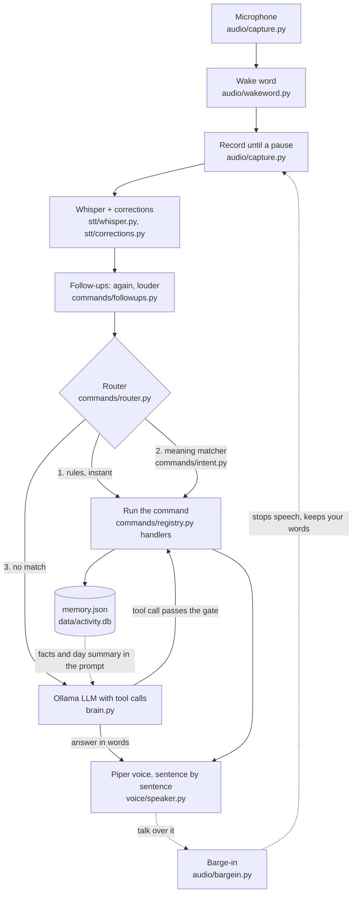

# ULTRON architecture

How the pieces fit. For why they are built this way, see the decisions (D1 to D30) in [BUILD_LOG.md](BUILD_LOG.md).

## The flow of one request

1. **Wake and record.** `app.py` waits for the wake word, then records until a short pause (`VAD_END_SILENCE_SECONDS`, found by Silero VAD).
2. **Transcribe.** Whisper (on the GPU when it fits, else the CPU) turns the audio into text; `config/corrections.json` fixes known mishearings.
3. **Route.** Three stages, fastest first: exact rules, a meaning matcher (model2vec embeddings compared with each command's example sentences, slots such as app names filled by fuzzy matching), then the LLM with the closest commands offered as tools. A tool call must pass a gate (similarity to the command's examples) or the user is asked "Did you mean ...?".
4. **Safety.** Risky commands always need a spoken "confirm", whichever stage chose them. Medium-impact ones are announced first so the user can interrupt.
5. **Speak.** Replies are synthesised sentence by sentence and played while the next one renders. Talking over ULTRON stops it.

## Modules (`src/ultron/`)

| Module | Job |
|---|---|
| `__main__.py` | `python -m ultron`, `--self-test`, `--benchmark` |
| `app.py` | Main loop and the voice interaction (confirm, announce, barge-in) |
| `config.py` | Settings from `.env`, the LLM system prompt |
| `paths.py` | Every file location (config, models, data, log) |
| `logger.py` | Console and rotating file log |
| `persona.py` | All of ULTRON's spoken lines and quips |
| `hardware.py` | Detects RAM, cores, GPU; picks the profile (models and devices) |
| `brain.py` | Ollama chat, streaming, tool calls, prompt building |
| `memory.py` | Conversation window and saved facts (`memory.json`) |
| `activity.py` | Activity log (`data/activity.db`), app tracker, day summaries |
| `benchmark.py` | `--benchmark`: profile plus a speech-to-text timing |
| `selftest.py` | `--self-test`: config, registry, profile; no devices |
| `audio/` | `capture` (one always-open mic stream and phrase recording), `vad` (Silero voice detection), `wakeword`, `bargein`, `sounds` |
| `stt/` | `whisper` (transcription, CPU fallback), `corrections` |
| `voice/` | `speaker` (Piper, streaming), `tts_text` (pronunciations) |
| `commands/` | The command system, below |

### `commands/`

| Module | Job |
|---|---|
| `registry.py` | `@command` declarations: name, description, parameters, risk, examples; dry-run mode |
| `router.py` | The three stages, slot filling, the gate on LLM tool calls, confirm and announce |
| `intent.py` | The meaning matcher (model2vec `potion-base-8M`) |
| `slots.py`, `apps.py` | Fill parameters (numbers, app names) from a sentence; the installed-app index |
| `text.py`, `context.py`, `followups.py`, `risky.py` | Normalising, "this window" context, "again", spoken confirm |
| `system.py`, `windows.py`, `general.py`, `clock.py` | PC, window, utility and clock commands |
| `git_helpers.py`, `developer.py` | Git and developer commands |
| `memory_cmds.py`, `activity_cmds.py` | Memory and activity-log commands |

## Files outside the code

`config/` (editable data), `models/` (downloads), `data/`, `memory.json`, `profile.md`, `ultron.log`, `.env` (private, git-ignored). Locations are defined once in `paths.py`.

## Tests and tools

- `tests/` run in dry-run mode: no commands execute, no audio, GPU, Ollama or large models. `tests/test_smoke.py` imports every module and runs the self-test.
- `tools/intent_eval.py` scores phrase understanding on `tests/intents.yaml`; `tools/gen_commands_txt.py` writes `docs/COMMANDS.md`; `tools/stt_benchmark.py` and `tools/llm_compare.py` compare models.
